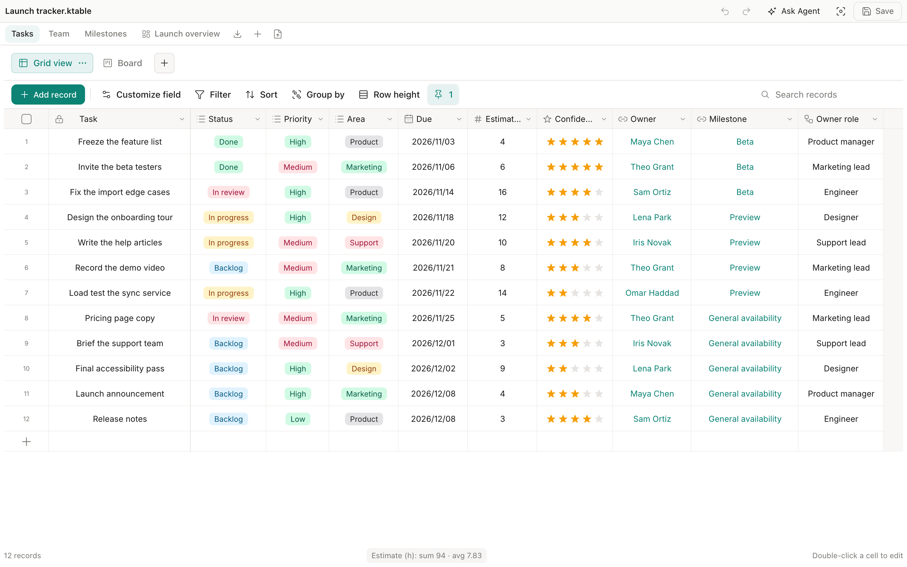
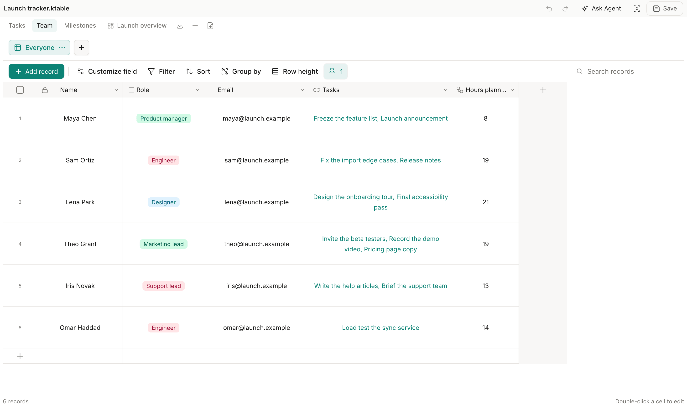
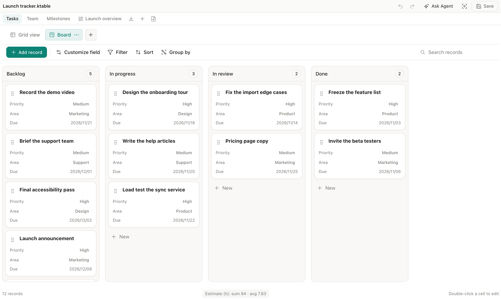
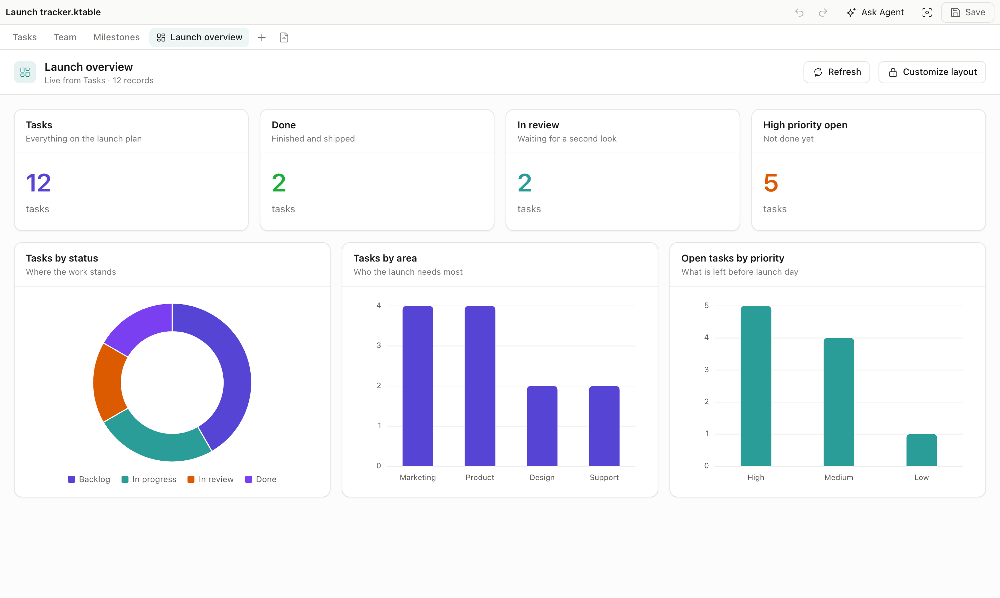
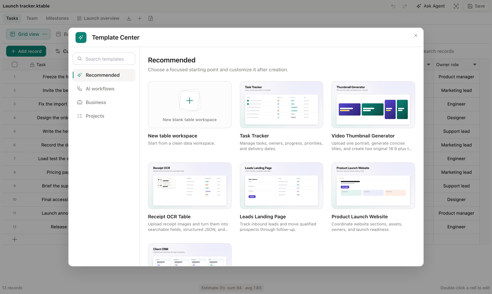
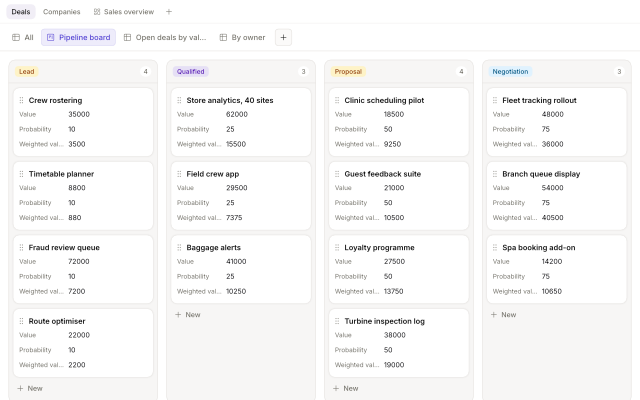
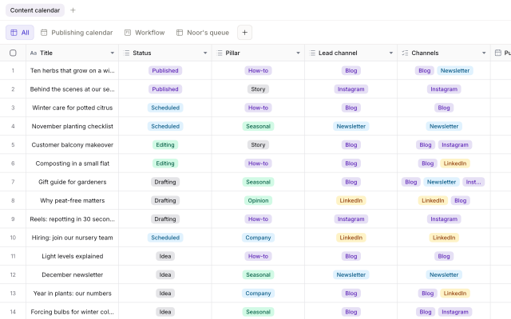
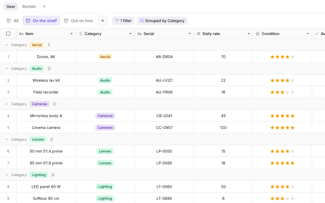
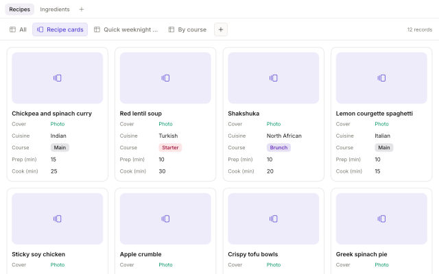

<div align="center">

# Kition Table

**A table editor you can drop into your app, that people and AI agents edit together, in one
file that holds every table, view and dashboard.**

Typed fields · Links and lookups · Grid, kanban, gallery and calendar views · Dashboards · CSV,
TSV and XLSX import · MCP tools for agents

[](LICENSE)
[](https://www.npmjs.com/package/@kition/embed)
[](https://github.com/kitharness/kitharness)
[](bindings/wasm)

[Use it in Kition](https://kition.ai) · [Embed it](#embed-it-in-your-app) · [Give it to your agent](#give-it-to-your-agent) · [Showcase](https://github.com/KitionAI/kition-showcase/tree/main/table) · [Developer docs](https://developer.kition.ai) · [KHP](https://github.com/kitharness/kitharness)

</div>

A Kition Table document is one `.ktable` file: a SQLite database holding its tables, their typed
fields and records, the views over them, and dashboards. The same Rust engine runs the editor in
the browser, compiled to WebAssembly, and serves agents headless, so a person and an agent work
on the same file. Every write an agent makes names what it read; a write that rests on something
someone else has since changed is refused instead of silently lost, and a write about something
else goes through.



## What it does

### Why Table

- **Real tables, one file.** Text, numbers, dates, single and multi select, checkboxes,
  ratings, attachments, links between tables, lookups, rollups, formulas and AI fields, in a
  file you can copy, mail or keep in a folder.
- **Views and dashboards.** Grid, kanban, gallery and calendar views with filters, sorts and
  groups, and dashboards of numbers, charts and tables.
- **Built for agents.** Agents read and edit tables through MCP tools that run the same engine
  and commands as the editor, with revision checks so neither side overwrites the other.
- **Embeds in any web page.** The editor runs in a sandboxed frame on your own origin, over your
  storage and your users. No Kition server in the loop; AI fields ask your page to run the model.
- **Fast and safe.** The engine is Rust, compiled to WebAssembly and run in a Web Worker, so large
  tables never block your page.
- **Open source.** Apache-2.0, engine and editor.

### See it

<table>
<tr>
<td width="50%">

<p><b>Tables that link.</b> Link records across tables, and show the other side's values with lookups and rollups. A two-way link shows the same links from both tables.</p>
</td>
<td width="50%">

<p><b>Views over the same records.</b> Grid, kanban, gallery and calendar views, each with its own filters, sorts and groups. Drag a card to another column to change its status.</p>
</td>
</tr>
<tr>
<td width="50%">

<p><b>Dashboards.</b> Counts, charts and tables over a table's records, laid out on a grid, kept live as the records change.</p>
</td>
<td width="50%">

<p><b>Start from a template.</b> Add a table from the Template Center, with its fields, views, sample records and dashboards, or start from a blank one.</p>
</td>
</tr>
</table>

### Made with Table

<table>
<tr>
<td width="25%"><a href="https://github.com/KitionAI/kition-showcase/tree/main/table/b2b-sales-pipeline"></a></td>
<td width="25%"><a href="https://github.com/KitionAI/kition-showcase/tree/main/table/garden-brand-content-calendar"></a></td>
<td width="25%"><a href="https://github.com/KitionAI/kition-showcase/tree/main/table/camera-gear-rentals"></a></td>
<td width="25%"><a href="https://github.com/KitionAI/kition-showcase/tree/main/table/family-recipe-box"></a></td>
</tr>
</table>

Every sample is built with Table's own commands. [See all of them](https://github.com/KitionAI/kition-showcase/tree/main/table).

### Formats

| Format | Extensions | MIME type | Role |
| --- | --- | --- | --- |
| ktable | .ktable | `application/vnd.kition.table+sqlite3` | edit |

New files are named `Untitled table.ktable` and hold one starter table. Tables export to CSV and
Markdown; CSV, TSV and XLSX files import with type inference.

## Quick start

### Use it in Kition

Open a `.ktable` file in Kition and it shows this editor. Kition's agent edits the same file,
through the same engine. [Download Kition](https://github.com/KitionAI/kition/releases/latest).

### Embed it in your app

Table's editor is a static package you host yourself, mounted into your page with the Kition
SDK's [`@kition/embed`](https://www.npmjs.com/package/@kition/embed). You keep the files and the
users; the editor reads and writes through the functions you give it.

1. Download `kition-table-<version>.tgz` from the
   [latest release](https://github.com/KitionAI/kition-table/releases/latest) and serve its
   `table-ui/` folder as static files on its own origin, with the headers in the
   [embed reference](https://github.com/KitionAI/kition-sdk/blob/main/docs/platform/reference/embed.md).
2. Install the SDK and mount the editor:

```sh
npm install @kition/embed
```

```ts
import { KitionEmbed } from '@kition/embed'

const editor = await KitionEmbed.mount(document.getElementById('table')!, {
  kit: { id: 'kit.table', url: 'https://kits.example.com/table-ui/' }, // the package you host
  file: { id: 'crm', name: 'CRM.ktable' },
  storage: {
    read: async (id) => api.read(id),                    // { bytes, version }
    write: async (id, bytes, { expectedVersion }) =>     // refuse a stale version
      api.write(id, bytes, expectedVersion),             // { version }
  },
  identity,          // optional: who is editing, and edit / comment / view per file
})
```

Every save carries the version it read, so an edit made elsewhere is never written over. A host
opens the editor at one table or dashboard with a view, `{ "path": "tables/<id>" }` or
`{ "path": "dashboards/<id>" }`. The [embed guide](https://github.com/KitionAI/kition-sdk/blob/main/docs/sdk/embed.md)
covers co-editing, theming, permissions, and an agent working inside the open editor with its
changes shown for review. AI fields run only when the host offers model calls (Kit UI protocol
`host/generate`); without them the editor hides their controls.

### Give it to your agent

The engine also runs headless, and `kition`, the Kition SDK's command line, serves it as MCP tools
(`table_inspect`, `table_run`, `table_check`, ...) on a folder of table files, for any MCP
client. Nothing is compiled: you need neither Rust nor the Kition app. Install `kition`, then
connect your agent in the folder:

```sh
npm install -g @kition/cli        # Node.js 20 or later; gives the kition command
kition agent add claude           # or codex, cursor: registers kition's MCP server
```

Without installing it:
`claude mcp add kition -- npx -y @kition/cli mcp --workspace "$PWD"`. Without Node.js, install
`kition` with `curl -fsSL https://github.com/KitionAI/kition-sdk/releases/latest/download/install.sh | sh`
(Windows: `irm https://github.com/KitionAI/kition-sdk/releases/latest/download/install.ps1 | iex`)
and run the same `kition agent add`.

`kition` holds no kit. The first time the agent opens a `.ktable` file, through the `kit_inspect`
tool the server offers until Table is installed, `kition` downloads Table's headless executable
into `~/.kition/kits` and the table tools appear. `kition kit install table` downloads it ahead
of time, and `kition kit upgrade` moves it to the newest version. Claude Desktop, Cursor, Codex
and the other commands are in the SDK's
[agent guide](https://github.com/KitionAI/kition-sdk/blob/main/docs/sdk/agent.md#connect-your-agent)
and [`kition` guide](https://github.com/KitionAI/kition-sdk/blob/main/docs/sdk/cli.md). To run
a build of your own (working on the kit itself), see the quick start in
[docs/development.md](docs/development.md#quick-start).

An agent reads the file, then runs commands by the ids it was given:

```json
table_inspect {"path": "crm.ktable"}
table_run {"path": "crm.ktable", "basis": "<revision>", "steps": [
  {"command": "table.records.create", "params": {"tableId": 1, "values": {"title": "Book the venue", "status": "To do"}}},
  {"command": "table.records.update", "params": {"tableId": 1, "recordId": 1, "values": {"status": "In progress"}}}
]}
table_check {"path": "crm.ktable"}
```

Every write names the revision it read (`basis`). Its answer lists what it changed, and what
others changed since that revision. A write that rests on something another writer has since
changed (a deleted record, a field whose type changed) is refused with a `conflict`, and nothing
is run. The agent's guide is [agent/guide.md](agent/guide.md).

## Maturity

Version 0.1.0 (`kit.json`, changes in [CHANGELOG.md](CHANGELOG.md)); KHP 1.0, conformance level `basic`.

The feature catalogue (`features.yaml`) lists every feature with its status and the cases that
prove it; known gaps are in [docs/gaps.md](docs/gaps.md).

Table is a kit of [Kition](https://kition.ai), built on the
[Kition SDK](https://github.com/KitionAI/kition-sdk).

## Build and contribute

Build and test instructions are in [docs/development.md](docs/development.md). Read
[CONTRIBUTING.md](.github/CONTRIBUTING.md) before opening a pull request, and ask questions in
[Discussions](https://github.com/KitionAI/kition/discussions) or on [Discord](https://discord.gg/bFSjRDjVY).

## License

Apache-2.0 ([LICENSE](LICENSE)). See [NOTICE](NOTICE) and [docs/attribution.md](docs/attribution.md).
